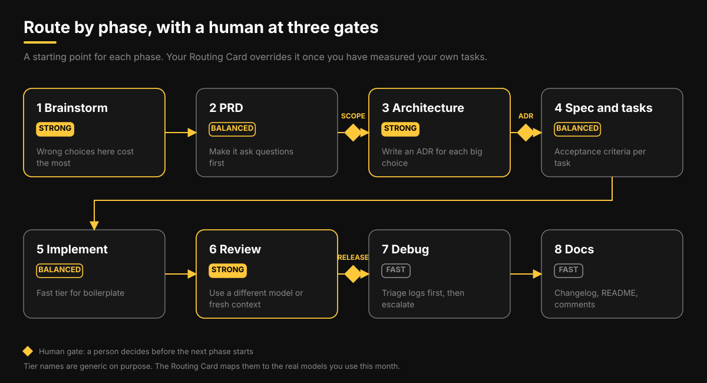

# AI Model Routing Handbook

Templates, checklists, prompts, and small scripts for deciding which AI model, at which effort level, with which safeguards, to use for each kind of software work. It is written around Claude Code, Codex, and Antigravity, but the method does not depend on them: you decide by task and by tier, then map tiers to whatever models exist this month.

The reasoning behind it is in the article on the blog: https://www.rafeuddaraj.me/blog



## What to trust, and what not to

Prices, model names, and flags change within weeks. Everything taken from a vendor or a third party is listed in [SOURCES.md](SOURCES.md) with how well it was checked. Numbers marked "assumed" only demonstrate a method. No benchmark here was run by the author, so run your own with the [test template](routing-kit/02-model-test-template.md). A dated list of the models used as examples is in [docs/model-snapshot-2026-11-07.md](docs/model-snapshot-2026-11-07.md).

## Start here

1. Copy [templates/AGENTS.md](templates/AGENTS.md) into your project and fill in the angle brackets. [CLAUDE.md](templates/CLAUDE.md) and [GEMINI.md](templates/GEMINI.md) import it, so each tool reads one set of rules. A filled-in example is in [templates/examples](templates/examples).
2. Run the three-task test in [routing-kit/02-model-test-template.md](routing-kit/02-model-test-template.md) on the models you can use.
3. Fill in the [Routing Card](routing-kit/01-routing-card.md) from your results.
4. Copy the [escalation rules](routing-kit/03-escalation-rules.md) you agree with into `AGENTS.md`.
5. Log decisions in the [Decision Log](routing-kit/05-decision-log.md) and review it monthly.

## What is in the kit

| Question | File |
|---|---|
| Which tier for this phase of a project? | [Routing Card](routing-kit/01-routing-card.md), [diagram](docs/diagrams/lifecycle-routing-pipeline.svg) |
| Which tier for this task? | [decision matrix](docs/diagrams/decision-matrix-2x2.svg) |
| Should different models plan, build, and review? | [diagram](docs/diagrams/planner-executor-reviewer.svg) |
| When to retry, climb a tier, or call a person? | [escalation rules](routing-kit/03-escalation-rules.md), [flow](docs/diagrams/escalation-flow.svg) |
| What goes in the prompt for each phase? | [phase prompts](routing-kit/04-phase-prompt-templates.md) |
| What to pass when switching models or sessions? | [handoff packet](routing-kit/07-handoff-packet.md) |
| Is the cheaper model really cheaper? | [cost per accepted output](routing-kit/06-cost-per-accepted-output.md) |
| How do I know the work is done? | [verification gates](routing-kit/10-verification-gates.md) |
| What does my language cost in tokens? | [token tax experiment](routing-kit/08-token-tax-experiment.md) |
| A new model shipped. Now what? | [30-minute checklist](routing-kit/09-new-model-checklist.md) |

Also here: an [ADR template](templates/adr-template.md), a [pull request template](.github/PULL_REQUEST_TEMPLATE.md) that records how a change was built and verified, Codex and Claude Code [config examples](templates), and CSV sheets for the routing card, test scores, decision log, and token counts.

## Scripts

Python 3.11 or newer, standard library only.

```
python3 scripts/cost_calculator.py --demo
python3 scripts/token_ratio.py my-token-tax.csv
python3 scripts/summarize_decision_log.py my-log.csv --markdown
python3 -m unittest discover -s tests
python3 scripts/validate_repo.py
```

## Contributing and license

Corrections with a source link are the most useful contribution: see [CONTRIBUTING.md](CONTRIBUTING.md). MIT license: see [LICENSE](LICENSE).
